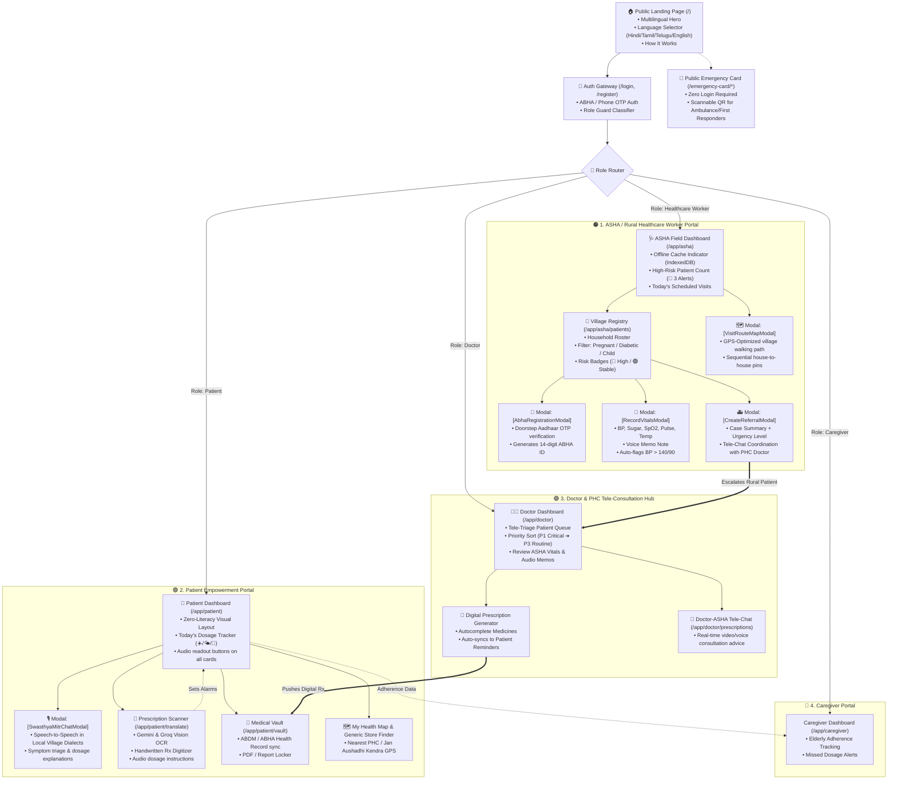

# 🏥 AI-Powered Rural Healthcare Assistant — Mentor Presentation & Figma Workflow Guide

This document is the complete **Screen-by-Screen Workflow and Architecture Map** of your project. It is structured to help you build the wireframes in **Figma / FigJam** or present directly to your mentor.

---

## 🎨 Fast-Track: How to use this in Figma right now
1. An editable vector file has been generated in your project root:  
   👉 **[`Healthcare_Assistant_Figma_Workflow.svg`](./Healthcare_Assistant_Figma_Workflow.svg)**
2. **Open Figma** $\rightarrow$ Open any project canvas.
3. **Drag & Drop** `Healthcare_Assistant_Figma_Workflow.svg` straight onto the Figma canvas.
4. It will immediately unpack into **fully editable native Figma frames, shapes, text boxes, and connector arrows**!

---

## 🗺️ Master Mermaid Workflow Diagram (Ready for Figma / GitHub / Excalidraw)

---

# 📖 Screen-by-Screen Mentor Pitch Points

When you walk your mentor through the Figma wireframe, explain these **4 Key Capabilities**:

### 1. The Doorstep ASHA Worker Workflow
* **Challenge Addressed:** Rural areas lack doctors; ASHA workers are the frontline healthcare providers.
* **The Solution:**
  1. ASHA worker logs into the **ASHA Field Dashboard** (`/app/asha`).
  2. Runs **100% offline** in remote villages using **IndexedDB caching**.
  3. When visiting a house, clicks **`[+ Register ABHA]`** to issue government ABHA health IDs on the spot.
  4. Clicks **`[Record Vitals]`** $\rightarrow$ logs BP and Sugar. If BP is critical (e.g. 150/100), the app automatically changes the patient badge to **🔴 High Risk**.
  5. Clicks **`[Refer to Doctor]`** $\rightarrow$ packages vitals and audio notes directly to the Primary Health Center (PHC) doctor.

### 2. Zero-Literacy Patient Experience (SwasthyaMitr AI)
* **Challenge Addressed:** Illiterate villagers cannot read handwritten doctor prescriptions or navigate complex web apps.
* **The Solution:**
  1. High-contrast icon layout with voice readouts on every card.
  2. Floating **SwasthyaMitr AI** button: Patients speak naturally in Hindi, Tamil, Telugu, etc., and receive audio responses explaining dosages and precautions.
  3. **Prescription Scanner:** Uses **Gemini 1.5 & Groq Vision OCR** to read messy doctor handwriting and automatically sets up morning/night WhatsApp & voice alarms.

### 3. Closed-Loop Doctor Tele-Triage
* **Challenge Addressed:** PHC doctors are overwhelmed and need prioritized patient data.
* **The Solution:**
  1. Doctor sees pre-triaged queues sorted by priority (`P1 Critical` to `P3 Routine`).
  2. Review AI-synthesized summaries of ASHA field notes.
  3. One-click digital prescription generation pushes directly into the patient's vault.

### 4. Public QR Emergency Card
* **Challenge Addressed:** First responders and ambulance drivers cannot unlock a patient's phone during an accident or emergency.
* **The Solution:**
  1. Public route `/emergency-card/*` accessible via a printable QR sticker or lock-screen card.
  2. Shows blood group, critical allergies, chronic conditions, and emergency contacts with zero login required.
